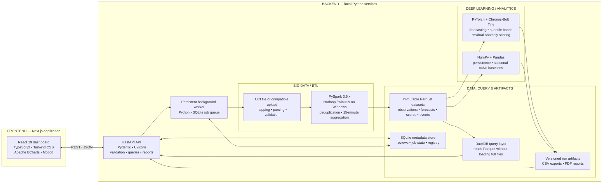

# VoltIQ

> Electricity forecasting and unusual-consumption analysis — a fully local, offline-capable web application for exploring household power data.

VoltIQ ingests raw electricity meter readings, runs a PySpark ETL pipeline, applies a **frozen Chronos-Bolt Tiny deep-learning model** for time-series forecasting, scores anomalies from calibrated residuals, and surfaces everything in an interactive Next.js dashboard — all running on your laptop with no cloud dependencies.

---

## Table of Contents

- [Features](#features)
- [Tech Stack](#tech-stack)
- [Architecture](#architecture)
- [Model Results](#model-results)
- [Setup and Run](#setup-and-run)
- [Application Pages](#application-pages)
- [Frontend Screenshots](#frontend-screenshots)
- [Project Structure](#project-structure)
- [Documentation Map](#documentation-map)
- [Data Attribution](#data-attribution)

---

## Features

- **Consumption Explorer** — full-resolution time series, daily heatmap, slot profiles, and sub-metering circuit breakdown
- **Deep-Learning Forecasting** — Chronos-Bolt Tiny (pretrained, frozen) with q10/q50/q90 quantile bands at 15 min, 1 h, and 4 h horizons; persistence and seasonal-naive baselines for comparison
- **Anomaly Detection** — residual-based candidate event scoring calibrated on a validation split; slot-MAD statistical reference; filterable event table with review notes
- **Peak Load Analysis** — configurable percentile threshold, excess-energy accounting, and event markers
- **Actionable Recommendations** — rule-based advisory cards combining peak and anomaly evidence
- **PDF and CSV Reports** — reproducible, frozen-snapshot exports (4 CSV kinds + ReportLab PDF)
- **Upload Wizard** — bring your own compatible CSV/TXT with an interactive mapping and preview step
- **Durable Job Queue** — SQLite-backed background worker with real stage progress, cancellation, and restart recovery
- **Fully Offline After Setup** — no paid APIs, no cloud storage, no authentication required

---

## Tech Stack

| Layer | Technology |
|---|---|
| Frontend | Next.js 16, React 19, TypeScript, Tailwind CSS, Apache ECharts, Motion for React |
| Backend API | FastAPI, Pydantic, Uvicorn |
| Background worker | Python, SQLite-backed job queue |
| ETL | PySpark 3.5.x |
| Forecasting | PyTorch, Chronos-Bolt Tiny (Amazon, pretrained) |
| Baselines | NumPy, Pandas (persistence, seasonal naive) |
| Query layer | DuckDB + Parquet (immutable artifacts) |
| Metadata store | SQLite |
| PDF reports | ReportLab |
| Server state | TanStack Query (URL-synced via Next.js router) |

---

## Architecture



The **Next.js frontend** talks to the **FastAPI backend** over REST/JSON. Inside the backend, the worker owns the Big Data pipeline (PySpark; Hadoop/`winutils.exe` is only the Windows filesystem support needed by Spark) and the Deep Learning pipeline (PyTorch + frozen Chronos-Bolt Tiny). Processed data is stored as immutable Parquet, queried through DuckDB, while SQLite stores metadata, reviews and job state.

---

## Model Results

Held-out test split on the 250,000-row (~174-day) UCI final dataset:

| Horizon | Model | MAE (kW) | RMSE (kW) | MASE | q10-q90 coverage |
|---|---|---|---|---|---|
| 15 min (H1) | Chronos-Bolt Tiny | 0.3174 | 0.5615 | 0.3145 | 83.1% |
| 1 h (H4) | Chronos-Bolt Tiny | 0.4376 | 0.7210 | 0.4336 | 79.7% |
| 4 h (H16) | Chronos-Bolt Tiny | 0.5447 | 0.8346 | 0.5397 | 78.8% |
| 15 min (H1) | Persistence baseline | 0.3129 | 0.5674 | 0.3101 | — |
| 1 h (H4) | Persistence baseline | 0.4631 | 0.7819 | 0.4589 | — |
| 4 h (H16) | Persistence baseline | 0.7088 | 1.0980 | 0.7023 | — |

Chronos outperforms persistence by **5.5% MAE at 1 h** and **23.2% MAE at 4 h**. At 15 min the two models are comparable. Chronos adds calibrated quantile bands unavailable from the persistence baseline.

**Anomaly detection:** 24 candidate events from 9,858 scored bins. Residual threshold 2.209 kW (q0.99 over 2,053 validation bins). Inference speed: median 9.4 ms/origin, p95 14.6 ms (CPU, float32).

---

## Setup and Run

The setup and operational instructions live outside this overview README:

- [QUICKSTART.md](QUICKSTART.md) — shortest path to install dependencies, configure Windows Hadoop, start the app, and run the checks.
- [instructions.md](instructions.md) — complete setup, dataset registration, Chronos preparation, evaluation, and test commands.

---

## Application Pages

| Route | What you get |
|---|---|
| `/` | Landing page with interactive night preview and two entry paths |
| `/overview` | Period energy, scored-period status, and recent candidate events |
| `/consumption` | Full time series, daily heatmap, slot profiles, circuit contribution |
| `/forecasting` | Origin-specific Chronos forecast with quantile band and baseline toggles |
| `/anomalies` | Filterable candidate event table with review status |
| `/anomalies/[id]` | Full event evidence, surrounding context, review note, and export |
| `/peak-load` | Demand threshold line, peak event markers, and excess-energy accounting |
| `/data` | Dataset inventory, upload wizard, mapping, quality report, job history |
| `/models` | Run configuration, held-out metrics, threshold calibration |
| `/recommendations` | Rule-based advisory cards from peak and anomaly evidence |
| `/reports` | Configurable PDF and CSV export with section controls |

---

## Frontend Screenshots

The main frontend flows are shown below:

### Landing page


### Overview dashboard


### Forecasting


### Anomaly detection


### Reports


---

## Project Structure

```
VoltIQ/
├── backend/
│   ├── app/
│   │   ├── main.py              # FastAPI routes and OpenAPI schema
│   │   ├── worker.py            # Job queue, subprocess execution, artifact publishing
│   │   ├── processing.py        # PySpark ETL and quality accounting
│   │   ├── models.py            # Chronos adapter, baselines, scoring, evaluation
│   │   ├── peak_load.py         # Peak load analysis
│   │   ├── recommendations.py   # Rule-based recommendations engine
│   │   ├── reporting.py         # ReportLab PDF generation
│   │   └── store.py             # SQLite entity and job state management
│   ├── tests/
│   │   ├── test_models.py
│   │   ├── test_workflow.py
│   │   ├── test_processing.py
│   │   └── test_peak_recommendations.py
│   ├── import_uci.py            # UCI dataset import helper
│   ├── prepare_model.py         # One-time Chronos checkpoint download
│   ├── requirements.txt
│   ├── requirements-ml.txt      # PyTorch + Chronos dependencies
│   ├── requirements-lock.txt
│   └── data/                    # Local runtime data (gitignored)
│       ├── models/
│       │   └── chronos-bolt-tiny/
│       │       ├── model.safetensors # Frozen Chronos checkpoint
│       │       ├── config.json
│       │       └── prepared.json
│       ├── datasets/             # Uploaded and processed dataset versions
│       ├── runs/                 # Forecast, score and event artifacts
│       ├── forecasts/            # On-demand forecast artifacts
│       ├── artifacts/            # CSV/PDF exports
│       ├── uploads/              # Incoming source files
│       ├── tmp/                  # Job-owned temporary files
│       └── metadata.sqlite3      # SQLite metadata and job state
├── voltiq/                      # Next.js application
│   ├── contracts/               # Backend OpenAPI JSON
│   ├── src/
│   │   ├── app/                 # App Router routes
│   │   ├── features/            # One file per route (business logic)
│   │   ├── components/          # Shared UI, charts, shell
│   │   ├── fixtures/            # Synthetic demo data
│   │   └── lib/                 # API client, state, time utilities, types
│   └── .env.example
├── LICENSE
├── QUICKSTART.md
├── instructions.md
└── README.md
```

---

## Documentation Map

| Document | Contents |
|---|---|
| [QUICKSTART.md](QUICKSTART.md) | Shortest path to first run on Windows |
| [instructions.md](instructions.md) | Full setup, dataset import, model prep, all test commands |

---

## Data Attribution

**UCI Individual Household Electric Power Consumption dataset**
Dua, D. and Graff, C. (2019). UCI Machine Learning Repository.
https://archive.ics.uci.edu/dataset/235/individual+household+electric+power+consumption

Inner TXT SHA-256: `4259c9d7ece5dbee9ab8d53682baac68d791c864f0f64a52b4043cb3b90894b7`

**Chronos-Bolt Tiny checkpoint**
Amazon Science. https://github.com/amazon-science/chronos-forecasting
Checkpoint: `amazon/chronos-bolt-tiny` revision `a0e552de83495b5c28c14c71c374f3e33280b340`

---

*VoltIQ shows what your electricity patterns reveal. Candidate anomalies are unusual intervals relative to a forecast, not verified faults or proven savings.*
