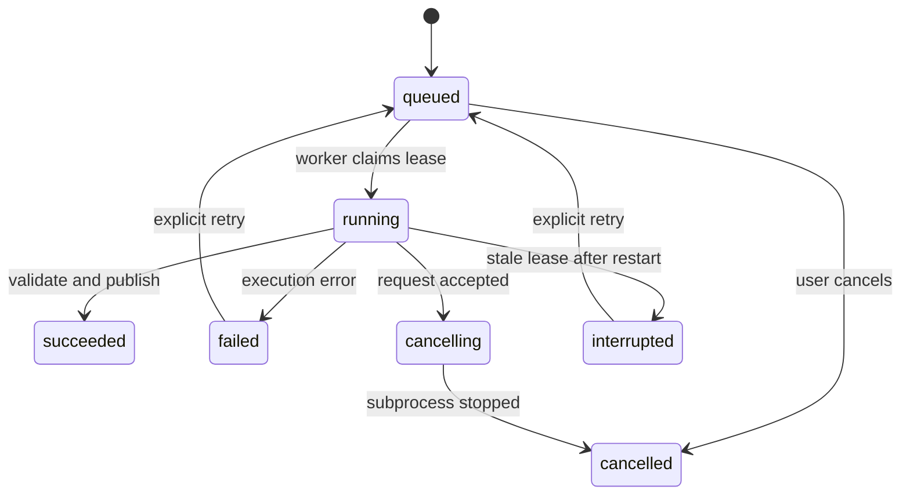

# Backend Specification — VoltIQ

Revision 2 · 12 October 2026. API and execution contract for the local application. These interfaces must be implemented and tested; this document is not an existing server manual.

## 1. Responsibilities and boundaries

FastAPI handles validation, metadata, bounded queries and artifact delivery. A separate persistent worker claims queued jobs and runs Spark/model/report subprocesses. DuckDB queries immutable Parquet. SQLite stores entities, review notes and job state. Normal page requests never run ETL, download a checkpoint or train a model.

Bind API and website to loopback by default. One local workspace is shared by all browser sessions; ten developers collaborate through source control, not simultaneous unprotected access to this local server.

## 2. Core entities

| Entity | Required fields / lifecycle |
|---|---|
| Dataset | `id`, label, source kind, source hash, mapping, profile, time basis, capabilities, created time, status |
| Dataset version | Immutable selected-data/config hash, exact coverage, schema `2.0`, manifest and artifact references |
| Run | `id`, dataset/version ID, model ID/revision, config hash, split manifest, evaluation kind, status, completed time |
| Job | `id`, kind, parameters hash, status, stage, progress counts, timestamps, error, attempt, cancel request |
| Event | `id`, run ID, detector, start/end, score summary, direction, evidence refs |
| Review | Event ID, status, plain-text note, updated time, integer revision |
| Report | `id`, run ID, date range, section selection, job ID, artifact checksum |
| Artifact | `id`, owner entity, relative registered path, MIME, checksum, size, schema |

Dataset lifecycle: `uploaded → needs_mapping → ready_for_processing → processing → ready`, with `failed` and retriable preprocessing as new attempts. Source/mapping changes generate a new dataset version; they do not mutate a completed version. Analysis runs are immutable after success. Review notes remain mutable and separate from scientific artifacts.

Opaque IDs are generated server-side. Labels and source filenames are display strings only. `created_at` timestamps are UTC and include `Z`; measurement timestamps are offset-free source time with `time_basis` in their envelope. Never confuse these two types.

## 3. Common API rules

Base path `/api/v1`. OpenAPI is the source for generated TypeScript clients. JSON numbers are finite; missing values are `null`, never NaN/Infinity. GETs are read-only. All analytical endpoints require explicit dataset/run identity; do not use a global server “current run.”

Query intervals are half-open `[from,to)` in source wall-clock time. If omitted, use the run's test interval for scored views, and dataset coverage for consumption. Persist explicit resolved ranges in response metadata. Validate `from < to`. Provide cursor pagination with a stable secondary ID sort; default 50, maximum 200 rows per page. Timeseries requests default to 2,000 display buckets with a maximum of 5,000. Full-resolution download is a separate export.

```json
{
  "data": [],
  "meta": {
    "schema_version": "2.0",
    "dataset_id": "ds_example",
    "run_id": "run_example",
    "time_basis": "source_local_naive",
    "from": "2007-05-01T00:00:00",
    "to": "2007-05-02T00:00:00",
    "next_cursor": null
  }
}
```

IDs and dates here are illustrative, not a saved result. Errors use `{error:{code,message,details,request_id}}`. Codes distinguish invalid schema (422), missing entity (404), version/busy conflict (409), resource limit (413/422), and internal failure (500). Do not expose filesystem paths or tracebacks to the UI; provide a local diagnostic identifier.

## 4. Endpoint inventory

| Method and path | Input / purpose | Output |
|---|---|---|
| GET `/health` | Dependency/readiness checks | API/worker/cache status; no heavy jobs |
| GET `/datasets` | Cursor | Dataset summaries and capabilities |
| POST `/datasets/uploads` | Multipart CSV/TXT | Dataset ID, detected columns, bounded preview |
| PUT `/datasets/{id}/mapping` | Explicit columns, units, format | Validated mapping, diagnostics, new version if needed |
| POST `/datasets/{id}/preprocess` | Profile, optional start date, idempotency key | 202 + job ID |
| GET `/datasets/{id}` | Identity | Manifest summary and readiness |
| GET `/datasets/{id}/quality` | Ready version | Coverage, counts, gap spans, EDA refs |
| GET `/datasets/{id}/series` | Range, channel, max buckets | Bucketed observations + quality |
| GET `/datasets/{id}/profiles` | Range, daily/slot/calendar view | Aggregates, coverage and denominators |
| POST `/runs` | Dataset version, model, evaluation/inference config | 202 + run/job IDs |
| GET `/runs` | Dataset filter, cursor | Available immutable runs |
| GET `/runs/{id}` | Run identity | Configuration, split/scored ranges, capabilities |
| GET `/runs/{id}/overview` | Range, all/overnight | KPIs with coverage and eligible counts |
| GET `/runs/{id}/scores` | Range, detector | Scores, threshold and per-bin status |
| GET `/runs/{id}/events` | Range, detector, direction, review, sort, cursor | Event summaries |
| GET `/events/{id}` | Event identity | Whole event, evidence, quality and review |
| PATCH `/events/{id}/review` | Status/note + expected revision | Updated review/revision |
| GET `/runs/{id}/metrics` | Optional horizon/model selection | Evaluation metrics and sample counts |
| GET `/runs/{id}/forecasts` | Origin, horizon, model | Saved backtest prediction |
| POST `/runs/{id}/forecasts` | Origin mode, horizon | 202 + job ID for new inference artifact |
| POST `/runs/{id}/threshold-previews` | Validation quantile 0.95–0.999 | 202 + exploratory preview job |
| POST `/experiments` | Approved optional experiment type/config | 202 + job/run IDs |
| POST `/bundles/import` | Approved result-bundle upload | Compatibility report/import job |
| GET `/jobs/{id}` | Job identity | State/stage/counts/log summary |
| GET `/jobs` | Status filter, cursor | Persistent activity list |
| POST `/jobs/{id}/cancel` | Cancel request | Accepted/current terminal state |
| POST `/reports` | Run, range, sections, format | 202 + report/job IDs |
| GET `/reports/{id}` | Report identity | Status, metadata and artifact IDs |
| POST `/exports` | Dataset/run, kind, filters | 202 + export job ID |
| GET `/artifacts/{id}/download` | Registered artifact | File with safe filename/content headers |

Ready datasets imported by maintainers as saved UCI results use the same manifests and validation as uploads. Do not ship a second unvalidated schema for demo results.

For a dataset with enough forecast context but insufficient evaluation history, `POST /runs` accepts `evaluation_kind="inference"`. It registers a model/configuration against that dataset version without splits, calibration or evaluation metrics. The forecasting page creates this inference run before calling its forecast endpoint. An inference run cannot populate anomaly or held-out comparison views. `held_out` run creation enforces the minimum evaluation history. Every completed job response includes its resulting run/report/artifact IDs, so exports and threshold previews can be retrieved without guessed paths.

## 5. Job request and durable state

```json
{
  "dataset_id": "ds_example",
  "dataset_version": "version_example",
  "model_id": "chronos_bolt_tiny",
  "evaluation_kind": "held_out",
  "config": {"context_bins":192,"horizons":[1,4,16],"threshold_quantile":0.99}
}
```

Client sends `Idempotency-Key` on mutation requests that create jobs. Store key + request hash + response. Same key/hash returns the original response; same key/different hash returns 409. UI disabling a button is not sufficient duplicate-job protection.



Retries create a new attempt, preserve prior logs, and never overwrite succeeded artifacts. Use a SQLite transaction to claim a queued job, WAL mode and a busy timeout. Worker heartbeat/lease expiry detects interruption. One heavy job at a time by default; short API reads remain responsive. Poll status every 2 seconds while active, back off in hidden tabs; SSE is an optional enhancement, not required infrastructure.

Progress reports actual completed/total work where meaningful. For unknown Spark-stage work, show named stage and elapsed time with indeterminate progress. Do not fabricate an ETA or a progress percentage driven by a timer.

Cancellation checks between work units and terminates job-owned subprocess groups when necessary. A cancel request is not completion: display `cancelling` until termination. Temporary artifacts remain unpublished. Atomic manifest publication plus DB completion occurs only after schema/checksum validation. On restart, reconcile already-published manifests before retrying to prevent duplicate output.

## 6. Measurement, score and forecast schemas

The full observations schema belongs to `Bigdata_integration.md`. API transforms Parquet timestamps into fixed source-time strings. Downsampling returns bucket start/end, mean/min/max observed power, observed energy sum, valid/expected minute counts and source-row count. Scores/events are queried separately so downsampling cannot erase candidate markers. KPI energy is computed from full-resolution data, not display buckets.

`forecasts.parquet`, one row per `(run_id, model_id, origin, horizon, step)`:

| Field | Rule |
|---|---|
| `origin`, `target_start`, `target_end` | Source timestamps, exact causal alignment |
| `horizon`, `step` | Integer bins; step 1..horizon |
| `q10_kw`, `q50_kw`, `q90_kw` | Nullable by capability; frozen Chronos requires all |
| `actual_kw` | Null for unavailable/unknown target |
| `target_eligible` | Boolean |
| `split`, `evaluation_kind` | Train/validation/test/future and held_out/exploratory/inference |
| `context_imputed_bins`, `context_bins` | Quality metadata |
| `model_revision` | Pinned identity |

`scores.parquet`, unique `(run_id, detector_id, bin_start)` for primary interval detectors:
`bin_start`, `bin_end`, `actual_kw`, `predicted_kw`, `score`, `score_unit`, `threshold`, `candidate`, `direction`, `status`, `skip_reason`, `split`, `baseline_kw`, `estimated_above_reference_kwh`.

`status` is `scored`, `not_scored`, `quality_excluded`, or `not_calibrated`. `candidate` is null unless status is scored. This prevents unscored data from appearing normal. Optional autoencoder uses separate window-support fields/artifact, never the interval primary key contract.

## 7. Event and review contract

Event summary contains `start`, `end`, `duration_minutes`, `flagged_bin_count`, `peak_score`, `score_unit`, `direction`, `estimated_above_reference_kwh`, and `reference_covered_bins`. Returned `visible_start`/`visible_end` describe intersection with a filter; the original event remains intact. Only whole-period evidence has the whole-event duration/energy label.

Review status is `unreviewed`, `reviewed`, or `needs_followup`; note limit 2,000 Unicode characters. Notes are plain text, escaped everywhere including PDF/CSV. Save with expected integer revision; stale edits receive 409 and the UI offers reload/copy of unsaved text. No reviewer identity is invented when there is no login. A note never becomes a verified ground-truth label.

## 8. Upload validation and local protection

Stream with size limits; allow `.csv`/`.txt` plain text only for raw readings. Reject archives on the raw upload endpoint, executable content, binary files, invalid encoding and path-like filenames. Check actual content, not only MIME/extension. Provide at most 100 preview rows. Generic uploads require explicit mapping and units before processing.

Never accept an arbitrary server path, shell command, model repository URL or Python object from a browser request. Allowlist model IDs and configurations. Use subprocess argument arrays with `shell=False`. Registered artifact IDs resolve within the configured storage root. Download requests cannot traverse directories.

Permit only configured localhost origins, validate Host/Origin for mutations, and use a per-launch application token available to the local frontend for mutating requests. This avoids treating loopback binding as complete protection against requests from unrelated web pages. No remote CORS wildcard.

Result bundles are separate trusted-format archives: bounded expanded size/file count, reject traversal/symlinks, validate JSON/Parquet and checksums, accept safetensors plus allowlisted config for weights, never unpickle arbitrary uploaded objects. Imported bundle dataset hash must match the registered version. A mismatch is an error, not an automatic remapping.

## 9. Reports and exports

PDF job freezes run, filters, metrics and current review-note snapshot. Build a local print page and render via Playwright using packaged fonts/assets; no remote asset dependency. Include source attribution, run/checkpoint/config identity, exact dates, coverage, scored periods, forecast horizon, evidence charts, method and limitations. Use light print surfaces with dark text and matching semantic colors.

CSV kinds: observations, forecasts, scores, events. Include units in column names and metadata sidecar in a ZIP export when needed. Escape spreadsheet formula prefixes in user-entered text cells; do not change legitimate numeric negatives. Exports use full-resolution filtered data and expose row counts. Keep report generation asynchronous and let users download only complete artifacts. Report notes must be an explicit selected section.

## 10. Caching and resource limits

Cache GET results by dataset version, run ID, parameters and review revision where relevant. Never cache by route alone. Use parameterized DuckDB queries. Cap date ranges by actual coverage, display points by 5,000 and event pagination by 200. Resource-limited requests return a descriptive error. A new dataset selection cannot reuse an old run's cached results.

Persist enough metadata to reproduce results without relying on in-memory state. Keep logs under job IDs with timings, status transitions and bounded diagnostic messages. Do not log full uploaded rows, tokens or full notes.

## 11. Verification and completion gates

Test numerical energy examples from the pipeline spec, causal origin alignment, null-vs-normal status, pagination stability, idempotent job creation, cancellation, restart reconciliation and review conflicts. Test invalid mapping, over-limit files, path traversal, a corrupted bundle and unavailable checkpoint. Verify one saved-run journey and one upload journey end-to-end.

Performance budgets are targets: cached metadata under 300 ms, a 2,000-bucket local chart response under 1 s, and job enqueue under 500 ms on the measured machine. Record observed p50/p95 and machine details; revise budgets transparently if needed. Heavy compute has no promised completion time until profiled.
