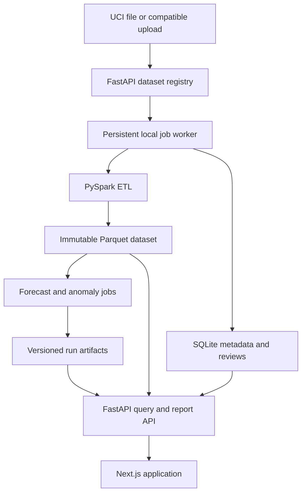

# VoltIQ

## Project specification — revision 2, 12 October 2026

A local-first electricity analytics website combining **PySpark data engineering, pretrained deep-learning forecasting, and candidate anomaly detection**. The product helps someone explore household consumption, forecast upcoming readings, inspect unusual intervals, and export evidence. It is a full Next.js application backed by FastAPI, not a Streamlit application.

**Document status:** implementation specification, not a claim that the application exists or has passed testing. All commands, structures, defaults, performance budgets and API examples below are proposed contracts to implement. This revision supersedes the previous four-day prototype specification across all six files.

## 1. Confirmed requirements and defaults

| Decision | Specification |
|---|---|
| Team and schedule | Ten people; milestone gates rather than a fixed deadline |
| Mandatory technology | PySpark performs ingestion, validation and aggregation |
| Deep learning | Pretrained inference is sufficient; fine-tuning and a custom network are optional experiments |
| Hardware | Intel Core 5 210H laptop; RAM and discrete GPU unspecified; CPU-first defaults |
| Optional compute | Free Colab for experiments; GPU availability and session length are not guaranteed |
| Operation | Fully local now; deployment preparation later |
| User journeys | Explore saved UCI results AND upload compatible data and run analysis |
| Features | Consumption exploration, forecasting, anomaly detection, pipeline inspection and reports |
| Visual direction | Midnight/cyan, polished interactive charts and purposeful animation |
| Authentication | No accounts in local v1; shared local workspace, not multi-user isolation |
| Data size | Development: 100,000 consecutive minute rows; final: 250,000; full source optional |
| Network | Initial dependency/dataset/checkpoint downloads may need internet; cached runtime works offline |

No further clarification is needed to write or begin implementing this scope. RAM discovery is a setup task: measure available memory before increasing worker concurrency or model size. Do not assume the CPU's NPU or integrated graphics supports the chosen PyTorch workload.

## 2. Product boundaries

The source contains historical readings, not verified appliance faults or phantom-load labels. A forecast deviation is a **candidate unusual interval**. A persistent high overnight level is a **reference comparison**. Neither proves avoidable waste, a faulty device, or financial savings. Retain the project name, with the subtitle “Electricity forecasting and unusual-consumption analysis.”

Local v1 does not require sensors, streaming infrastructure, paid inference APIs, Hadoop/HDFS, Kubernetes, authentication, a multi-household fleet, or automated appliance identification. These are outside the agreed implementation, not prerequisites for a premium website.

## 3. System architecture



| Layer | Selected technology | Responsibility |
|---|---|---|
| Website | Next.js, React, TypeScript | Routes, application shell, interactive workflows |
| UI | Tailwind CSS, accessible headless controls | Shared tokens and components |
| Motion | Motion for React, CSS, SVG | Transitions, selected states, historical replay |
| Charts | Apache ECharts | Timelines, quantile bands, brushing and heatmaps |
| API | FastAPI, Pydantic | Validation, queries, jobs, reports, OpenAPI |
| Background execution | One Python worker + SQLite-backed queue | Durable, bounded local jobs |
| ETL | PySpark | Raw parsing, quality accounting and 15-minute aggregation |
| Forecasting | PyTorch + Chronos-Bolt Tiny adapter | Pretrained univariate active-power forecasting |
| Baselines | NumPy/Pandas | Persistence, daily seasonal naive, slot medians |
| Query storage | Parquet + DuckDB | Filtered analytical reads without loading whole files |
| Metadata | SQLite | Datasets, runs, jobs, artifact manifests and review notes |
| Reports | HTML print layout + local Playwright PDF | Reproducible PDF and CSV exports |

Use a single ML framework. If implementing the optional autoencoder, use PyTorch; do not add TensorFlow solely for this comparison. Neither Spark nor model inference runs inside a normal HTTP request or a page render.

## 4. Dataset and scientific scope

The UCI Individual Household Electric Power Consumption dataset records one household. Use its original semicolon-delimited text file with date/time, active/reactive power, voltage, intensity and three sub-metering channels. Record source citation, downloaded-file hash and license in the dataset manifest. See the primary source in §12 for the published description.

Select consecutive timestamp-sorted records; never randomly sample rows. For a complete minute cadence, 100,000 rows span about 69 days and 250,000 about 174 days. Actual retained periods and sample counts come from the pipeline. A selected dataset must have at least 28 calendar days for the v1 evaluation workflow; shorter valid uploads remain explorable but do not produce an evaluation run.

Use 15-minute bins for modeling. Keep all hours for forecasting and residual detection. Provide an overnight view of 00:00–05:00; do not concatenate nights into a continuous forecast series. Preserve missingness and coverage instead of presenting absent values as zero.

## 5. Model decision

**Required:** Chronos-Bolt Tiny pretrained inference, persistence and daily seasonal-naive forecasts, and a statistical anomaly reference. Derive the principal detector from one-step forecast residuals calibrated on validation data. This reuses a deep-learning forecast engine for both requested capabilities while keeping their evaluation distinct.

**Optional:** fine-tune Chronos on Colab; train a compact autoencoder; compare a larger pretrained checkpoint only after profiling. Optional experiments must not delay the first complete application or silently replace the selected model. Record the checkpoint revision and investigate pretraining overlap with UCI; local chronological holdout does not prove the checkpoint never encountered this dataset.

Forecast horizons are 1, 4 and 16 intervals (15 minutes, 1 hour and 4 hours). A 24-hour option is an extension with its own evaluation; do not silently enable a horizon outside the locked adapter's tested support.

## 6. User journeys

### A. Explore saved results

Open landing → choose “Explore saved analysis” → select available UCI run → inspect overview → brush a period → open an event → review the forecast evidence → save a note → export a report. If no saved run exists, show setup steps; synthetic fixtures require explicit demo selection.

### B. Analyze an upload

Upload CSV/TXT → map timestamp and power/unit fields → preview parsing → confirm import → run Spark preprocessing → inspect quality → choose evaluation or forecast mode → queue model job → see actual stage status → open completed results. Schema-invalid uploads remain in a clear failed/needs-mapping state. Incomplete jobs do not appear as successful analyses.

### C. Forecast from the dataset endpoint

Select dataset/run and horizon → use the latest eligible context → generate forecast → display origin and target historical dates → download forecast CSV. It predicts after the dataset endpoint, not after today's wall clock. A historical backtest origin is a separate mode with hidden future targets until evaluation.

## 7. Page inventory

| Route | Final user output |
|---|---|
| `/` | Product explanation, interactive night preview and two entry paths |
| `/overview` | Period energy/coverage, scored-period status and recent candidate events |
| `/consumption` | Linked trends, heatmap, daily profiles and measured circuit contribution |
| `/forecasting` | Origin-specific prediction, quantile band and compatible baseline comparison |
| `/anomalies` | Filterable candidate events with review status |
| `/anomalies/[id]` | Event evidence, surrounding context, provenance and review note |
| `/data` | Dataset inventory, upload wizard, quality report and preprocessing progress |
| `/models` | Run configuration, evaluation, calibration and optional experiments |
| `/reports` | Configurable, reproducible PDF/CSV outputs |

`frontend_spec.md` defines every page, control, dependency, state and acceptance check. `design.md` defines composition, tokens, animations and design-reference decisions.

## 8. Proposed repository and developer workflow

| Path | Ownership |
|---|---|
| `apps/web/` | Next.js routes, shared components, chart adapters, API client |
| `services/api/` | FastAPI routes, schemas and application services |
| `services/worker/` | Job claiming, subprocess execution and artifact publishing |
| `packages/pipeline/` | Spark ingestion, quality and aggregation |
| `packages/ml/` | Baselines, model adapters, backtesting, scoring, evaluation |
| `packages/contracts/` | Versioned schema definitions and generated TypeScript types |
| `configs/default.yaml` | Central reproducible defaults |
| `notebooks/` | EDA and optional Colab experiments |
| `tests/` | Contract, chronology, numerical and workflow tests |
| `var/` | Ignored runtime datasets, results, cache and SQLite |

Commands below are **target interfaces to implement**, not existing scripts:

```bash
python -m services.api --host 127.0.0.1 --port 8000
python -m services.worker --concurrency 1
npm --prefix apps/web run dev -- --hostname 127.0.0.1
python -m packages.pipeline.cli --profile development --dataset-id DATASET_ID
python -m packages.ml.cli evaluate --dataset-id DATASET_ID --model chronos_bolt_tiny
```

Provide a Windows PowerShell launcher after these commands work independently. Lock package versions and the Node runtime after one end-to-end compatibility smoke test; do not use unbounded `latest` requirements. Proposed Spark compatibility baseline: Python 3.11, Java 17 and PySpark 3.5.7, tested on the actual Windows machine (WSL2 may be documented as an alternative). Separate Colab experiment dependencies from the application lockfile.

## 9. Ten-person work allocation

| Person | Primary ownership | Deliverable / integration partner |
|---|---|---|
| 1 | Coordination and contracts | Schema versioning, integration branch, acceptance gates; everyone |
| 2 | Spark ingestion | UCI and upload normalization; person 3 |
| 3 | Quality and analytical data | Coverage, Parquet, EDA and ETL benchmarks; 2 and 4 |
| 4 | Forecasting | Chronos adapter, baselines and backtests; 5 and 6 |
| 5 | Anomaly evaluation | Thresholds, events, synthetic tests and optional autoencoder; 4 |
| 6 | API and registry | Queries, metadata, generated client contracts; 7 and 8 |
| 7 | Worker and exports | Queue, cancellation, report artifacts and local packaging; 6 and 10 |
| 8 | Frontend workflows | Application shell, upload, jobs, model and report pages; 6 |
| 9 | Visual and chart system | Landing, consumption, forecasts, event interactions; 8 |
| 10 | QA and reproducibility | Fixtures, cross-browser flows, numerical checks, demo guide; all |

These are ownership roles, not isolated silos. Review schema changes with downstream owners before merging. Each feature pull request includes one person from a consuming component as reviewer.

## 10. Milestone gates

1. **Contracts and visual foundations:** stable IDs, schemas, fixture run, tokens and route shell agreed.
2. **Data vertical slice:** upload/UCI → Spark → quality report → consumption chart, with correct energy units.
3. **Scientific vertical slice:** baselines + Chronos → chronological backtest → calibrated residuals → event detail.
4. **Complete workflows:** persistent jobs, cancellation, review notes, dataset-end forecast and PDF/CSV.
5. **Presentation quality:** specified motion, keyboard flows, responsive layouts, empty/error states and offline cached demo.
6. **Final evidence:** 250k run, measured runtime/memory, baseline comparisons, known limitations and fresh-machine setup check.
7. **Optional research:** fine-tuning, autoencoder, full-source run; separate results and versions.

## 11. Completion criteria and future deployment

A clean local startup must open actual saved artifacts without starting Spark or training. Both user journeys must complete, survive a page refresh, and produce exports traceable to one dataset and run. Forecast metrics must use eligible held-out targets. Dataset/run changes must not mix household results. Every visible button either works or explains why the action is unavailable.

For later deployment, replace local filesystem storage with object storage, SQLite with a server database where needed, add authentication/authorization and per-user isolation, configure TLS/origin protections, and move the worker to managed compute. Keep IDs and artifact contracts portable now; do not implement cloud infrastructure in local v1.

## 12. Document map and sources

- [Frontend specification](frontend_spec.md): pages and user interaction contracts.
- [Backend specification](backend_spec.md): API, jobs, entities, uploads and exports.
- [Design specification](design.md): research synthesis, visual tokens and motion.
- [Deep-learning specification](Deeplearning_backend.md): experiments and scientific evaluation.
- [Big-data specification](Bigdata_integration.md): dataset semantics and mandatory Spark pipeline.

Primary sources checked 12 October 2026:
- UCI dataset and citation: https://archive.ics.uci.edu/dataset/235/individual+household+electric+power+consumption
- Chronos repository: https://github.com/amazon-science/chronos-forecasting
- Checkpoint card: https://huggingface.co/amazon/chronos-bolt-tiny
- PySpark compatibility: https://spark.apache.org/docs/3.5.7/api/python/getting_started/install.html

Source facts inform the design; configuration defaults, architecture, UI behavior and acceptance criteria are project decisions. No benchmark or model-quality result is asserted by this specification.
